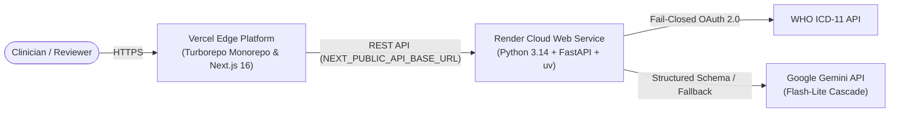

# 🚀 Production Deployment Guide: Vercel (Turborepo) & Render

This guide outlines how to deploy the **Evidence-Checked ICD-11 Coding Assistant** production monorepo:
- **Frontend (`apps/frontend`)**: Next.js 16 (App Router + Turbopack) deployed on **Vercel** with full **Turborepo** build caching.
- **Backend (`apps/backend`)**: FastAPI (Python 3.14 + `uv` + Google GenAI) deployed as a Web Service on **Render**.

---

## 📑 Monorepo Architecture Overview



---

## Part 1: Deploying the Python FastAPI Backend on Render

Deploy the FastAPI backend first so you obtain its live HTTPS URL (e.g., `https://sugen-backend.onrender.com`).

### Step 1: Create a Web Service on Render
1. Log in to [Render Dashboard](https://dashboard.render.com/) and click **New +** $\rightarrow$ **Web Service**.
2. Connect your GitHub repository: **`Callme-VR/sugen.health`**.
3. Fill in the service configuration:
   - **Name**: `sugen-backend` (or your choice)
   - **Region**: Frankfurt / Singapore / Oregon (pick closest to your users)
   - **Branch**: `main`
   - **Root Directory**: `apps/backend`
   - **Runtime**: `Python 3`
   - **Build Command**:
     ```bash
     pip install uv && uv sync --frozen --no-dev
     ```
   - **Start Command**:
     ```bash
     uv run uvicorn app.main:app --host 0.0.0.0 --port $PORT
     ```
   - **Instance Type**: `Free` (or `Starter`)

### Step 2: Configure Environment Variables in Render
Under the **Environment** tab, add the following key-value pairs:

| Variable | Value | Description |
|---|---|---|
| `ICD_MODE` | `mock` *(or `live`)* | Use `mock` for local evaluation, `live` for WHO cloud |
| `ICD_CLIENT_ID` | `your_who_client_id` | Required only if `ICD_MODE=live` |
| `ICD_CLIENT_SECRET` | `your_who_client_secret` | Required only if `ICD_MODE=live` |
| `ICD_RELEASE` | `2025-01` | WHO ICD-11 release identifier |
| `LLM_PROVIDER` | `google` | Selected LLM backend |
| `LLM_API_KEY` | `your_gemini_api_key` | From [Google AI Studio](https://aistudio.google.com/apikey) |
| `LLM_MODEL` | `gemini-flash-lite-latest` | Primary model (cascade falls back automatically) |
| `DATA_DIR` | `./data` | Path to synthetic notes and tables |
| `DECISION_LOG` | `./data/decisions.jsonl` | Append-only audit log path |
| `ALLOWED_ORIGIN` | `https://sugenhealth.vercel.app` | Vercel domain (update once Vercel deploys) |

### Step 3: Deploy & Verify
1. Click **Create Web Service**.
2. Wait for the build to finish. Once live, test the health check in your browser:
   ```
   https://<your-render-subdomain>.onrender.com/health
   ```
   Expected response: `{"status": "ok"}`.
3. Copy your live Render URL for Part 2.

---

## Part 2: Deploying the Next.js Frontend on Vercel with Turborepo

Vercel natively supports Turborepo monorepos, enabling remote caching, zero-config Turbopack builds, and instant rollbacks.

### Step 1: Import the Monorepo into Vercel
1. Go to your [Vercel Dashboard](https://vercel.com/dashboard) and click **Add New...** $\rightarrow$ **Project**.
2. Import your GitHub repository: **`Callme-VR/sugen.health`**.
3. In the **Configure Project** screen, configure the following:
   - **Framework Preset**: `Next.js`
   - **Root Directory**: Click **Edit** and select **`apps/frontend`** (leave *"Include source files outside of the Root Directory in the Build Step"* **CHECKED** so Turborepo can access workspace dependencies).

### Step 2: Configure Build & Development Settings
Under **Build and Output Settings**, toggle **Override** if needed (Vercel automatically detects Turborepo):
- **Build Command**: `cd ../.. && turbo run build --filter=frontend`
- **Output Directory**: `.next`
- **Install Command**: `bun install` (or leave default if using bun)

### Step 3: Configure Environment Variables in Vercel
Expand **Environment Variables** and add:

| Key | Value | Notes |
|---|---|---|
| `NEXT_PUBLIC_API_BASE_URL` | `https://<your-render-subdomain>.onrender.com` | Your live Render backend URL from Part 1 |

### Step 4: Deploy
1. Click **Deploy**.
2. Vercel will install dependencies across the monorepo, invoke Turborepo caching, compile the Next.js 16 app with Turbopack, and assign you a production URL (e.g., `https://sugen-health.vercel.app`).

---

## Part 3: Connecting the CORS Loop

Now that your Vercel deployment URL is live:
1. Open your **Render Dashboard** $\rightarrow$ **sugen-backend** $\rightarrow$ **Environment**.
2. Update `ALLOWED_ORIGIN` to match your exact Vercel URL:
   ```env
   ALLOWED_ORIGIN=https://sugenhealth.vercel.app
   ```
3. Save changes (Render will perform a zero-downtime rolling restart).

---

## Part 4: Production Verification Checklist

Run through this checklist to ensure your live deployment is operating smoothly:

- [ ] **Liveness**: `https://<your-render-app>.onrender.com/health` returns `{"status":"ok"}`.
- [ ] **Catalog Load**: `https://<your-vercel-app>.vercel.app/` loads all 30 synthetic notes with zero CORS errors in browser devtools.
- [ ] **Extraction & Verifier**: Open any encounter note (e.g. `note_01` or `note_02`) and click **"Extract & Verify ICD-11 Codes"**:
  - Gemini Flash-Lite extracts candidate conditions.
  - Verifier colors evidence spans (Green: `Verified`, Amber: `Needs Review`, Rose: `Rejected`).
- [ ] **Audit Trail**: Clicking **Approve** or **Edit Code** updates the append-only audit trail in real-time.
- [ ] **Safety Rails**: Rejected cards are collapsed by default; approving an overridden code enforces a written justification.
- [ ] **Clinical Disclaimer**: Footer disclaimer is visible on all pages (*"Demo on synthetic data. Not certified for live clinical decision support."*).
