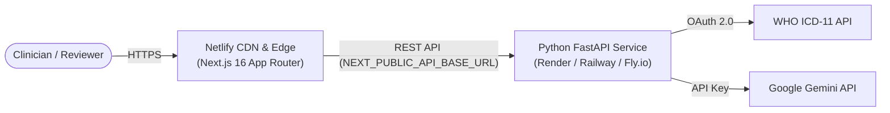

# 🚀 Production Deployment Guide: Netlify & Cloud Backend

This guide outlines how to deploy the **Evidence-Checked ICD-11 Coding Assistant** for production demonstration:
- **Frontend**: Next.js 16 (App Router + Turbopack) deployed on **Netlify**.
- **Backend**: FastAPI (Python 3.14 + uv + Google GenAI) deployed on a container platform (e.g., **Render**, **Railway**, or **Fly.io**) since Netlify is optimized for JavaScript/TypeScript edge and static sites.

---

## 📑 Architecture Overview



---

## Part 1: Deploying the Python FastAPI Backend

Before deploying the frontend on Netlify, deploy your FastAPI backend so you have a live API URL (e.g., `https://icd-backend.onrender.com`).

### Option A: Render (Free & Simplest)

1. **Sign in to [Render](https://render.com/)** and connect your GitHub repository (`Callme-VR/sugen.health`).
2. Click **New +** $\rightarrow$ **Web Service**.
3. Configure the service:
   - **Root Directory**: `apps/backend`
   - **Environment**: `Python 3`
   - **Build Command**: `pip install uv && uv sync --frozen --no-dev`
   - **Start Command**: `uv run uvicorn app.main:app --host 0.0.0.0 --port $PORT`
4. **Environment Variables**: Add your backend environment variables in Render's dashboard:
   ```env
   ICD_MODE=mock
   LLM_PROVIDER=google
   LLM_API_KEY=your_gemini_api_key_here
   LLM_MODEL=gemini-flash-lite-latest
   DATA_DIR=./data
   DECISION_LOG=./data/decisions.jsonl
   ALLOWED_ORIGIN=https://your-netlify-app-name.netlify.app
   ```
5. Click **Create Web Service**. Once deployed, copy your backend URL (e.g., `https://icd-backend-xyz.onrender.com`).

---

## Part 2: Deploying Next.js on Netlify

### Step 1: Netlify Configuration File

In your repository root or `apps/frontend`, create a `netlify.toml` file to configure Netlify's build engine for Next.js in a monorepo.

Create [`d:\sugen\workflow\apps\frontend\netlify.toml`](file:///d:/sugen/workflow/apps/frontend/netlify.toml):
```toml
[build]
  command = "bun run build"
  publish = ".next"

[[plugins]]
  package = "@netlify/plugin-nextjs"
```

---

### Step 2: Deploy via Netlify Web Dashboard (Recommended)

1. **Sign in to [Netlify](https://app.netlify.com/)** with your GitHub account.
2. Click **Add new site** $\rightarrow$ **Import an existing project**.
3. Select your repository: **`Callme-VR/sugen.health`**.
4. Configure the **Monorepo Build Settings**:
   - **Base directory**: `apps/frontend`
   - **Package directory**: `apps/frontend`
   - **Build command**: `bun run build` (or `npm run build` / `bun next build`)
   - **Publish directory**: `apps/frontend/.next`
5. Click **Environment Variables** $\rightarrow$ **Add variable**:
   - **Key**: `NEXT_PUBLIC_API_BASE_URL`
   - **Value**: `https://your-backend-app.onrender.com` (your live FastAPI backend URL from Part 1)
6. Click **Deploy Site**.

---

### Step 3: Deploy via Netlify CLI (Alternative)

If you prefer deploying directly from your terminal:

1. **Install Netlify CLI**:
   ```bash
   bun add -g netlify-cli
   ```
2. **Authenticate with Netlify**:
   ```bash
   netlify login
   ```
3. **Link and Deploy from `apps/frontend`**:
   ```bash
   cd apps/frontend
   netlify init
   ```
4. **Set your Environment Variable**:
   ```bash
   netlify env:set NEXT_PUBLIC_API_BASE_URL "https://your-backend-app.onrender.com"
   ```
5. **Trigger Production Build**:
   ```bash
   netlify deploy --build --prod
   ```

---

## Part 3: Connecting CORS

Once your Netlify site is live (e.g., `https://icd-assistant.netlify.app`), update your backend's CORS setting so the frontend can securely call `/notes` and `/notes/{id}/analyze`:

In your Render/Railway dashboard:
```env
ALLOWED_ORIGIN=https://icd-assistant.netlify.app
```
FastAPI will now accept cross-origin requests from your Netlify domain.

---

## Part 4: Production Verification Checklist

- [ ] Backend health check responds `200 OK`: `https://your-backend.onrender.com/health`
- [ ] Netlify site loads the note catalog cleanly without connection errors.
- [ ] Clicking **"Extract & Verify ICD-11 Codes"** runs the deterministic verifier and displays colored evidence spans in the text.
- [ ] Decision audit trail records approvals and edits in real-time.
- [ ] Footer disclaimer is visible: *"Demo on synthetic data. Not certified for live clinical decision support."*

