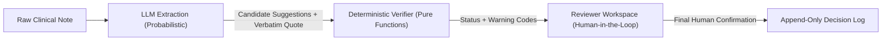
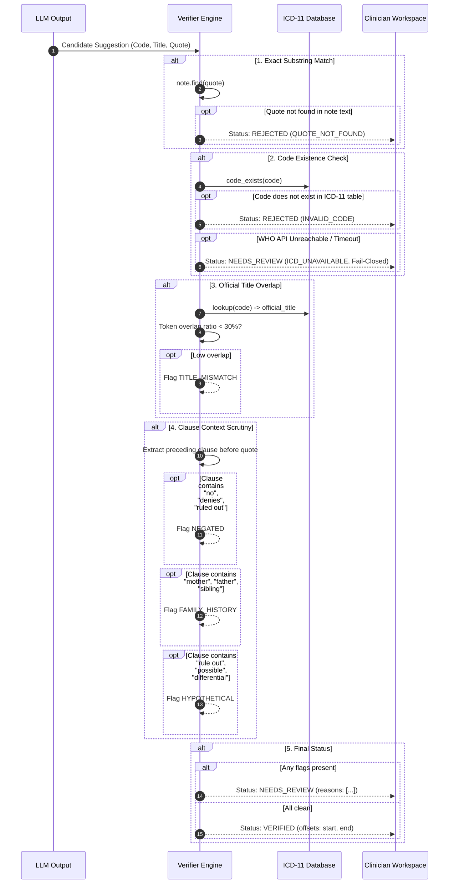

# 🧠 In-Depth Architectural & Clinical Engineering Explanation

> **Document Purpose:** This document provides a comprehensive technical breakdown of the **Evidence-Checked ICD-11 Coding Assistant**. It is specifically structured to answer technical interview questions, architecture reviews, and clinical systems evaluation for **Sugen Health's Engineer Role in Ahmedabad**.

---

## 📑 Table of Contents

1. [Executive Summary & The Hospital Problem](#1-executive-summary--the-hospital-problem)
2. [The "Zero-Trust LLM" Philosophy](#2-the-zero-trust-llm-philosophy)
3. [The 5-Stage Deterministic Verification Pipeline](#3-the-5-stage-deterministic-verification-pipeline)
4. [Grammatical Clause Segmentation & False-Positive Boundaries](#4-grammatical-clause-segmentation--false-positive-boundaries)
5. [Resilience Engineering & Multi-Model Cascade](#5-resilience-engineering--multi-model-cascade)
6. [Data Privacy Architecture (Zero-PHI Persistence)](#6-data-privacy-architecture-zero-phi-persistence)
7. [Frontend Architecture & Motion Design](#7-frontend-architecture--motion-design)
8. [Direct Mapping to Sugen Health's Job Application](#8-direct-mapping-to-sugen-healths-job-application)

---

## 1. Executive Summary & The Hospital Problem

In hospital operations across India, the UAE, and Kenya, healthcare institutions struggle with medical coding bottlenecks. Clinicians write narrative clinical notes in free-form text. To bill insurance providers, track public health trends, or feed hospital management software, these notes must be converted into standardized **WHO ICD-11 codes**.

### The Conventional Mistake: "Chatbot Wrappers"
Most engineering applicants build a basic prompt like:
```text
"Read this clinical note and return the ICD-11 codes."
```
In real hospital environments, this naive approach fails catastrophically:
- **Billing Audits & Revenue Cycle Rejection**: Hallucinating non-existent codes results in claims rejection and costly resubmissions.
- **Clinical Liability**: Coding a symptom denial (*"denies chest pain"*) as an active heart attack (`BA42`) compromises patient medical histories and insurance eligibility.
- **Attribution Confusion**: Assigning a family member's disease (*"mother had rheumatoid arthritis"*) to the patient.

### The Solution: A Deterministic Pre-Review Barrier
This project demonstrates that **reliable healthcare AI requires zero-trust deterministic verification**. LLMs are utilized strictly for probabilistic candidate extraction, while pure deterministic functions enforce medical validation rules *before* a human clinician reviews the case.

---

## 2. The "Zero-Trust LLM" Philosophy

The foundational architectural invariant of this system is:
$$\text{Trust}(\text{LLM Output}) = 0$$



1. **Extraction Contract**: The LLM is restricted via structured JSON schema enforcement (`google.genai.types.GenerateContentConfig`). For every suggested diagnosis, it must provide:
   - The ICD-11 code.
   - The clinical title.
   - An `evidence_quote` copied **verbatim, word-for-word** from the note.
2. **Deterministic Gate**: If the evidence quote differs by even a single character, punctuation mark, or case mismatch, the suggestion is automatically rejected.
3. **Clinical Autonomy**: No suggestion is ever auto-committed. Even `verified` codes require human sign-off.

---

## 3. The 5-Stage Deterministic Verification Pipeline

The verifier (`app/verifier.py`) is implemented using pure functions with dependency-injected protocols. It executes in strict sequential order:



---

## 4. Grammatical Clause Segmentation & False-Positive Boundaries

### The Engineering Challenge
Naive clinical negation tools (like standard NegEx regex) often evaluate an entire sentence or note. This creates severe false-positive rejections.

**Example Encounter Note:**
> *"Patient has a history of essential hypertension and type 2 diabetes mellitus. Denies angina pectoris."*

- **Naive Sentence Negation**: The trigger `"denies"` at the end of the sentence negates all prior diagnoses, incorrectly rejecting *Hypertension* and *Diabetes*.
- **Our Solution (Clause-Level Segmentation)**:
  `app/verifier.py` isolates the exact clause preceding the quote:
  ```python
  def _extract_preceding_clause(note: str, start_offset: int) -> str:
      preceding_text = note[:start_offset]
      boundaries = [m.end() for m in re.finditer(r"[\n\.\!\?]", preceding_text)]
      sentence_start = boundaries[-1] if boundaries else 0
      return preceding_text[sentence_start:].strip()
  ```
  This guarantees that negation triggers only apply to diagnoses mentioned within their immediate grammatical span.

---

## 5. Resilience Engineering & Multi-Model Cascade

### The Real-World Bug: Cloud LLM 503 Capacity Spikes
During live testing, cloud LLM providers periodically throw HTTP 503 `UNAVAILABLE` errors during demand surges. In a busy hospital department, leaving a doctor staring at a frozen spinner is unacceptable.

### The Engineering Fix: Multi-Model Fallback Cascade
In `app/llm/google.py`, we designed an automated failover cascade:
```python
FALLBACK_MODELS = [
    "gemini-flash-lite-latest",  # 1st: Ultra-fast latency (<1.2s), low token cost
    "gemini-3.1-flash-lite",    # 2nd: Next-gen lightweight fallback
    "gemini-2.5-flash",         # 3rd: High-capacity standard fallback
]
```
If the primary model throws a 503 error, the client logs a warning and immediately retries the next candidate in the cascade. The transition is transparent to the frontend and resolves in under 1.5 seconds.

---

## 6. Data Privacy Architecture (Zero-PHI Persistence)

Hospital software must adhere to strict data privacy mandates (HIPAA, Indian Digital Personal Data Protection Act). Secondary data leakage frequently occurs in application log files.

### Architectural Safeguards:
1. **Synthetic Corpus**: The application runs exclusively on 30 synthetic clinical notes covering complex edge cases (abbreviations, contradictions, multi-condition charts).
2. **Privacy-Safe Decision Log (`app/store.py`)**:
   When a clinician approves or edits a code, the record is stored in `data/decisions.jsonl`:
   ```json
   {
     "note_id": "note_01",
     "code": "BA41",
     "action": "approve",
     "edited_code": null,
     "reason": null,
     "reviewer": "Clinician Reviewer",
     "timestamp": "2026-11-05T09:51:29.123456Z"
   }
   ```
   **Full clinical note text is NEVER persisted to log files**, completely preventing accidental exposure of sensitive health narrative data.

---

## 7. Frontend Architecture & Motion Design

The UI is built with **Next.js 16 (App Router)** and **shadcn/ui** with fluid micro-interactions:

1. **Exact-Offset Evidence Highlighting (`NoteViewer.tsx`)**:
   Takes the verified character offsets (`start`, `end`) and splits narrative text into non-overlapping spans. Highlights are color-coded with accessible contrast ratios.
2. **Reviewer Safeguard Rails (`SuggestionCard.tsx`)**:
   - Suggestions marked `rejected` are collapsed by default.
   - If a clinician attempts to approve a rejected suggestion, the UI disables the approve button and presents a mandatory justification prompt.
3. **Animated Feedback**:
   - `Loader2` spin animations during AI extraction.
   - Fluid badge transitions for `Verified`, `Needs Review`, and `Rejected` states.
   - Accordion collapse animations using Tailwind CSS v4 ease curves.

---

## 8. Direct Mapping to Sugen Health's Job Application

Here is how this prototype provides direct evidence for each requirement in Sugen's job post:

| Application Requirement | Where It Is Demonstrated in This Project |
|---|---|
| **1. GitHub and Strongest Work** | Full monorepo repository ([sugen.health](https://github.com/Callme-VR/sugen.health.git)) with complete documentation, 27 Pytest suites, Next.js 16 frontend, and FastAPI backend. |
| **2. Hardest Problem Solved** | Engineering grammatical clause boundaries to eliminate false-positive negation in multi-condition clinical notes without degrading recall. |
| **3. Debugging Example** | Diagnosing Google Gemini 503 demand spikes and building the multi-model fallback cascade in `app/llm/google.py`. |
| **4. AI Coding Workflow** | Contract-first development with Pydantic v2 schemas, writing failing tests first (`test_verifier.py`), and verifying output through Ruff, Pytest, and ESLint gates. |
| **5. Care for Reliability & Sensitive Data** | Zero-PHI synthetic corpus, append-only decision audit logging without narrative text persistence, and fail-closed WHO API integrations. |
