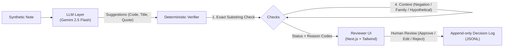

# Evidence-Checked ICD-11 Coding Assistant

> **Disclaimer:** This project is an engineering prototype and portfolio demo built exclusively on synthetic clinical data. It is **not** certified clinical software and must **never** be used for medical diagnosis, treatment planning, or live patient care.

---

## Overview

Modern LLMs frequently hallucinate medical codes, conflate familial medical history with active patient conditions, or ignore clinical negation (e.g., coding *"denies chest pain"* as angina). 

This project implements an **evidence-checked ICD-11 coding assistant** designed around the principle of zero trust in LLM outputs. Suggestions generated by Google Gemini are rigorously verified by a deterministic rule-based engine before ever being presented to a human clinician for final sign-off.

### Pipeline Architecture



---

## Monorepo Stack

- **Monorepo Engine**: [Turborepo](https://turbo.build/) with [Bun](https://bun.sh/)
- **Frontend** (`apps/frontend`): Next.js 16 (App Router), TypeScript, Tailwind CSS, Turbopack
- **Backend** (`apps/backend`): Python 3.14+, FastAPI, Pydantic v2, `uv`, `google-genai` SDK, `httpx`, `pytest`, `respx`, `ruff`
- **Data & Storage**: Plain files (synthetic `.txt` clinical notes, `labels.json`, `mock_icd.json`, append-only `decisions.jsonl`). No database required.

---

## Verifier Rules & Enforcement Pipeline

Suggestions carry an exact `evidence_quote` from the clinical note. The verifier executes sequentially:

1. **`QUOTE_NOT_FOUND`**: The quote must be an exact, case-sensitive substring of the note. Start and end character offsets are extracted for UI highlighting. If missing $\rightarrow$ **`rejected`**.
2. **`INVALID_CODE`**: Code must exist in the ICD-11 classification table (Mock ICD or live WHO ICD API) $\rightarrow$ **`rejected`**.
3. **`TITLE_MISMATCH`**: The official ICD-11 title and the LLM's suggested title must exceed the word overlap threshold $\rightarrow$ **`needs_review`**.
4. **Context Rules (Clause Level)**: Scans the clause preceding the quote for triggers:
   - **`NEGATED`** (e.g., *no, denies, without, negative for, ruled out, absence of*) $\rightarrow$ **`needs_review`**.
   - **`HYPOTHETICAL`** (e.g., *possible, suspected, rule out, query, differential*) $\rightarrow$ **`needs_review`**.
   - **`FAMILY_HISTORY`** (e.g., *mother, father, sibling, family history of*) $\rightarrow$ **`needs_review`**.
5. **Verified**: If all checks pass $\rightarrow$ **`verified`**.

> [!NOTE]
> Even `verified` codes require explicit human action. No code is ever auto-committed without clinician sign-off.

---

## Getting Started

### Prerequisites

- **Node.js** >= 20 LTS (or Bun 1.3+)
- **Python** >= 3.11 with [uv](https://github.com/astral-sh/uv)
- **Google Gemini API Key** (from [Google AI Studio](https://aistudio.google.com/apikey))

### 1. Environment Setup

Configure the backend environment:
```bash
cp apps/backend/.env.example apps/backend/.env
```

Edit `apps/backend/.env`:
```env
ICD_MODE=mock                        # 'mock' for local dev/eval, 'live' for WHO API
ICD_CLIENT_ID=
ICD_CLIENT_SECRET=
ICD_RELEASE=
LLM_PROVIDER=google
LLM_API_KEY=your_gemini_api_key_here
LLM_MODEL=gemini-2.5-flash
DATA_DIR=./data
DECISION_LOG=./data/decisions.jsonl
ALLOWED_ORIGIN=http://localhost:3000
```

Configure the frontend environment:
```env
# apps/frontend/.env.local
NEXT_PUBLIC_API_BASE_URL=http://localhost:8000
```

### 2. Development

Run frontend and backend services:

```bash
# Start Next.js frontend (http://localhost:3000)
bun run dev

# Start FastAPI backend (http://localhost:8000)
bun run dev:backend
```

---

## Testing & Quality Assurance

```bash
# Run backend pytest suite (unit tests, verifier contract, mock HTTP)
bun run test:backend

# Lint backend code with Ruff
bun run lint:backend

# Lint frontend & shared workspaces
bun run lint

# TypeScript verification
bun run check-types
```

---

## Evaluation Benchmark & Failure Log

The evaluation framework (`apps/backend/eval/run_eval.py`) benchmarks LLM extraction performance against a synthetic corpus tagged for edge cases (*negations, family history, hypothetical conditions, abbreviations, multi-condition notes*).

### Verifier Metrics

| Metric | Target | Description |
|---|---|---|
| **Precision** | > 90% | Proportion of `verified` suggestions matching ground truth labels |
| **Catch Rate** | > 95% | Erroneous LLM suggestions caught as `needs_review` or `rejected` |
| **False Rejection Rate** | < 5% | Valid ground-truth diagnoses incorrectly rejected by verifier |

### Mistakes the AI Made & Verifier Catches

| Scenario | Raw LLM Output | Verifier Intervention | Outcome |
|---|---|---|---|
| **Negated condition** | Codes *Angina pectoris* from *"patient denies chest pain"* | Flagged trigger `denies` preceding quote in clause | Marked **`needs_review`** (`NEGATED`) |
| **Family history** | Codes *Type 2 Diabetes* from *"mother diagnosed with T2D"* | Flagged trigger `mother` in clause | Marked **`needs_review`** (`FAMILY_HISTORY`) |
| **Hallucinated code** | Invented ICD-11 code not present in release | Code existence validation check failed | Marked **`rejected`** (`INVALID_CODE`) |
| **Paraphrased quote** | Summarized symptom rather than exact quote | Substring matching failed against raw note | Marked **`rejected`** (`QUOTE_NOT_FOUND`) |

---

## Repository Structure

```text
workflow/
├── apps/
│   ├── backend/
│   │   ├── app/
│   │   │   ├── main.py          # FastAPI application & CORS
│   │   │   ├── config.py        # Settings via Pydantic
│   │   │   ├── models.py        # Domain & API schemas
│   │   │   ├── verifier.py      # Deterministic verification rules
│   │   │   ├── store.py         # Append-only JSONL decision log
│   │   │   ├── llm/             # LLM client abstractions (Google GenAI)
│   │   │   └── icd/             # Mock & Live WHO ICD-11 clients
│   │   ├── data/
│   │   │   ├── notes/           # Synthetic clinical notes (.txt)
│   │   │   ├── labels.json      # Ground truth labels with edge-case tags
│   │   │   └── mock_icd.json    # Standardized ICD-11 codes
│   │   ├── eval/
│   │   │   ├── run_eval.py      # Evaluation pipeline & metrics generator
│   │   │   └── cache/           # Replayable LLM response cache
│   │   └── tests/               # Pytest suite
│   └── frontend/
│       └── src/
│           ├── app/             # Next.js App Router (Note list, Review workspace)
│           ├── components/      # NoteViewer, SuggestionCard, StatusBadge
│           └── lib/api.ts       # Typed API client
└── packages/
    ├── eslint-config/
    ├── typescript-config/
    └── ui/                      # Shared design system components
```

---

## License

MIT
